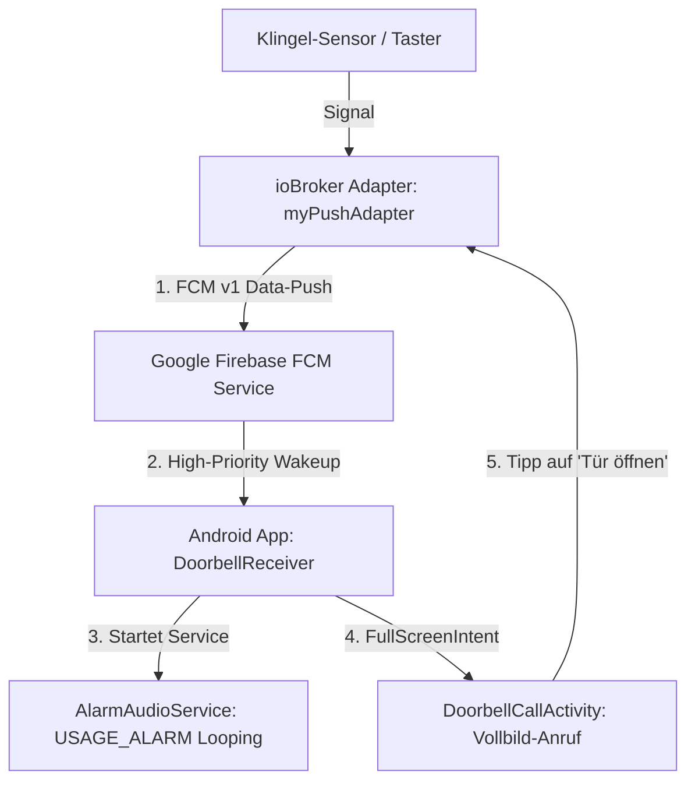

# 04. Entwickler-Konzept: Eigene App & ioBroker-Adapter (`myPushAdapter`)

Falls du dich gegen fertige Dienste (Pushover / ntfy) entscheidest und **eine komplett eigene Android-App mit maßgeschneidertem ioBroker-Adapter** entwickeln möchtest, dient dieses Dokument als architektonische Vorlage.

---

## 1. Warum eine eigene App bauen?

Fertige Push-Apps zeigen nur Text und Buttons. Eine eigene App bietet zusätzliche Möglichkeiten:
1. **Echtes Anruf-Design:** Ein Vollbild-Interface mit animierten Buttons ("Annehmen" / "Ablehnen").
2. **Direktes Kamera-Livebild:** Beim Klingeln zeigt der Anruf-Bildschirm sofort das Bild der Haustür-Kamera.
3. **Zwei-Wege-Steuerung:** Du kannst direkt im Vollbild-Fenster auf **"Tür öffnen"** tippen. Die App schickt den Befehl per REST/WebSocket zurück an ioBroker.

---

## 2. System-Komponenten



---

## 3. Der ioBroker Adapter (`myPushAdapter`)

Der Node.js Adapter im Projektverzeichnis `myPushAdapter` übernimmt zwei Aufgaben:
1. **Push-Versand:** Sendet bei Änderung eines Datenpunkts eine hochpriore FCM-Nachricht.
2. **Rückkanal (API):** Nimmt Bestätigungen oder Türöffner-Befehle von der App entgegen.

### Erforderliche ioBroker-Datenpunkte
* `myPushAdapter.0.trigger` (boolean): Wenn `true`, wird der Anruf-Push abgesetzt.
* `myPushAdapter.0.last_call_status` (string): `ringing`, `acknowledged`, `timeout`.
* `myPushAdapter.0.door_open_requested` (boolean): Wird auf `true` gesetzt, wenn der Nutzer in der App auf "Tür öffnen" tippt.

### Push-Versand via Firebase Admin SDK (Node.js)
```javascript
const admin = require("firebase-admin");

// FCM Nachricht erstellen (Data-Only Push für maximale Kontrolle im Hintergrund)
const message = {
    token: userDeviceToken,
    android: {
        priority: "high",
        ttl: 60 * 1000 // 60 Sekunden Gültigkeit
    },
    data: {
        type: "DOORBELL_CALL",
        title: "Haustürklingel",
        message: "Jemand steht vor der Tür!",
        camera_snapshot_url: "http://192.168.1.50/snapshot.jpg",
        timestamp: Date.now().toString()
    }
};

await admin.messaging().send(message);
```

---

## 4. Die Android-App (Kotlin / Android SDK)

### A. Erforderliche Android-Berechtigungen (`AndroidManifest.xml`)
```xml
<manifest xmlns:android="http://schemas.android.com/apk/res/android">
    <!-- Aufwecken des Bildschirms im gesperrten Zustand -->
    <uses-permission android:name="android.permission.USE_FULL_SCREEN_INTENT" />
    <uses-permission android:name="android.permission.WAKE_LOCK" />
    <uses-permission android:name="android.permission.VIBRATE" />
    <uses-permission android:name="android.permission.POST_NOTIFICATIONS" />
    
    <!-- Zugriff auf DND / Nicht-Stören-Bypass -->
    <uses-permission android:name="android.permission.ACCESS_NOTIFICATION_POLICY" />
    
    <application ...>
        <activity
            android:name=".DoorbellCallActivity"
            android:showWhenLocked="true"
            android:turnScreenOn="true"
            android:launchMode="singleTop"
            android:excludeFromRecents="true" />
    </application>
</manifest>
```

### B. Empfang des FCM-Pushes (`DoorbellFirebaseService.kt`)
```kotlin
class DoorbellFirebaseService : FirebaseMessagingService() {

    override fun onMessageReceived(remoteMessage: RemoteMessage) {
        if (remoteMessage.data["type"] == "DOORBELL_CALL") {
            triggerFullScreenCall(
                title = remoteMessage.data["title"] ?: "Türklingel",
                snapshotUrl = remoteMessage.data["camera_snapshot_url"]
            )
        }
    }

    private fun triggerFullScreenCall(title: String, snapshotUrl: String?) {
        val fullScreenIntent = Intent(this, DoorbellCallActivity::class.java).apply {
            flags = Intent.FLAG_ACTIVITY_NEW_TASK or Intent.FLAG_ACTIVITY_CLEAR_TOP
            putExtra("snapshot_url", snapshotUrl)
        }

        val pendingIntent = PendingIntent.getActivity(
            this, 0, fullScreenIntent,
            PendingIntent.FLAG_UPDATE_CURRENT or PendingIntent.FLAG_IMMUTABLE
        )

        // Notification mit USAGE_ALARM und FullScreenIntent
        val notification = NotificationCompat.Builder(this, "doorbell_channel")
            .setSmallIcon(R.drawable.ic_doorbell)
            .setContentTitle(title)
            .setContentText("Klingelt...")
            .setPriority(NotificationCompat.PRIORITY_MAX)
            .setCategory(NotificationCompat.CATEGORY_CALL)
            .setFullScreenIntent(pendingIntent, true) // <- DAS öffnet die Activity im Sperrbildschirm
            .setAutoCancel(true)
            .build()

        val manager = getSystemService(NotificationManager::class.java)
        manager.notify(1001, notification)
    }
}
```

### C. Der Vollbild-Bildschirm (`DoorbellCallActivity.kt`)
```kotlin
class DoorbellCallActivity : AppCompatActivity() {

    private var mediaPlayer: MediaPlayer? = null

    override fun onCreate(savedInstanceState: Bundle?) {
        super.onCreate(savedInstanceState)
        
        // Bildschirm entsperren und anschalten
        if (Build.VERSION.SDK_INT >= Build.VERSION_CODES.O_MR1) {
            setShowWhenLocked(true)
            setTurnScreenOn(true)
            val keyguardManager = getSystemService(KeyguardManager::class.java)
            keyguardManager.requestDismissKeyguard(this, null)
        } else {
            window.addFlags(
                WindowManager.LayoutParams.FLAG_SHOW_WHEN_LOCKED or
                WindowManager.LayoutParams.FLAG_TURN_SCREEN_ON or
                WindowManager.LayoutParams.FLAG_KEEP_SCREEN_ON
            )
        }

        setContentView(R.layout.activity_doorbell_call)
        startAlarmSound()
    }

    private fun startAlarmSound() {
        // Spielt den Ton über den Alarm-Kanal im Loop ab (ignoriert DND)
        val alarmUri = RingtoneManager.getDefaultUri(RingtoneManager.TYPE_ALARM)
        mediaPlayer = MediaPlayer().apply {
            setDataSource(applicationContext, alarmUri)
            setAudioAttributes(
                AudioAttributes.Builder()
                    .setUsage(AudioAttributes.USAGE_ALARM)
                    .setContentType(AudioAttributes.CONTENT_TYPE_SONIFICATION)
                    .build()
            )
            isLooping = true
            prepare()
            start()
        }
    }

    fun onAcknowledgeClick(view: View) {
        // Klingelton stoppen und Fenster schließen
        mediaPlayer?.stop()
        mediaPlayer?.release()
        finish()
    }

    fun onOpenDoorClick(view: View) {
        // Sendet Befehl an ioBroker via REST/HTTP
        sendOpenDoorCommandToIoBroker()
        onAcknowledgeClick(view)
    }
}
```

---

## 5. Zusammenfassung & Aufwandschätzung

* **Eigene App + Adapter:** Bietet die absolut beste User-Experience (Kamerabild, "Tür öffnen"-Button, Anruf-UI), benötigt jedoch Entwicklungsaufwand für Android (Android Studio / Kotlin) und den ioBroker-Adapter.
* **Fertiger Weg (Skript 1 / Pushover):** Bietet zu 90 % das gleiche Ergebnis (bricht DND, lauter Dauerton bis zur Quittierung), ist jedoch **innerhalb von 5 Minuten mit dem fertigen JavaScript betriebsbereit**.

